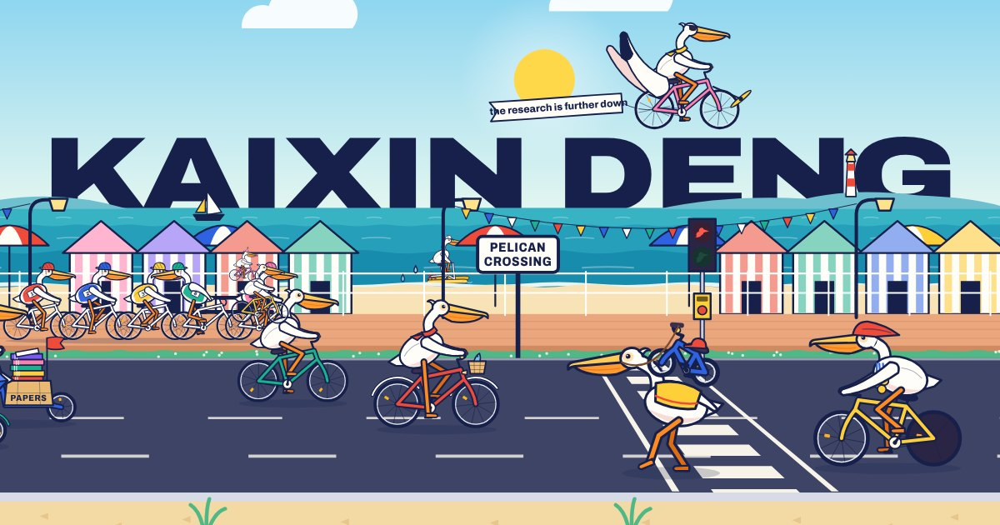

# Kaixin Deng 的个人主页：一路骑自行车的鹈鹕



线上地址：<https://www.dengkaixin.com>

这个主页是对“鹈鹕测试”的一份超长答卷。2024 年 10 月起，Simon Willison 让每个新发布的大模型都“Generate an SVG of a pelican riding a bicycle”，这句提示词后来成了很多人测新模型的第一件事（[他的合集](https://simonwillison.net/tags/pelican-riding-a-bicycle/)）。模型对这道题只答一次，这个页面答了二十来次，而且大部分是故意答错的。

页面上半屏是一条首尾相接的海滨公路，下半部分是正常可读的个人信息、论文、奖项和联系方式。

## 路上都有谁

共 21 份“答卷”，每一份都不一样，都有自己的动作和裁定结果：

| 编号 | 名字 | 画的是什么 |
| --- | --- | --- |
| 01 | 对照组 | 一只鹈鹕骑自行车。唯一按题目作答的 |
| 02 | 倒反天罡 | 自行车骑鹈鹕 |
| 03 | 递归 | 鹈鹕骑自行车，自行车上又是鹈鹕骑自行车，共三层 |
| 04 | 摸鱼双人车 | 前面蹬车，后面举着鱼竿钓前面那只 |
| 05 | 旧版模型 | 大小轮，礼帽，单片眼镜 |
| 06 | 参数减半 | 独轮车上抛接三条鱼 |
| 07 | 场地方 | 鱼在鹈鹕喉囊里骑车 |
| 08 | 融合怪 | 鹈鹕本身就是自行车，车座上坐着鱼 |
| 09 | 鹈鹕牌车轮 | 两个车轮是卷起来的鹈鹕 |
| 10 | 过拟合 | 动感单车，踏频很高，行驶 0 公里 |
| 11 | 深度思考中 | 站在车旁数 token，数到 128,000 也没骑上去 |
| 12 | 2024 年基线 | 一个椭圆、一个三角、两个圆 |
| 13 | 文献综述 | 货运车，货箱里是论文（卡片可跳到论文列表） |
| 14 | 通讯作者 | 折叠车邮差（卡片可跳到联系方式） |
| 15 | 领奖台常客 | 计时赛车加奖牌（卡片可跳到奖项） |
| 16 | 脚踏飞行 | 给自行车装了翅膀，拖着横幅在天上飞 |
| 17 | 送子鹈鹕 | 叼着一辆新生的小自行车 |
| 18 | 鹈鹕大集团 | 木栈道上的五人车队，其中一只倒着坐 |
| 19 | 分布外样本 | 海面上的水上自行车 |
| 20 | 微调进行中 | 带辅助轮的雏鸟 |
| 21 | 鹈鹕过街 | 英国真有一种信号灯人行横道叫 pelican crossing |

## 可以怎么玩

- **拖动**（或触控板横向滑动、方向键）左右看，世界是循环的，往哪边走都走不到头。
- **点一位骑手**：镜头跟上去，弹出评测卡片。再点一次或点卡片上的按钮，触发它的专属动作。
- **点空白处**扔一条鱼，离得最近的鹈鹕会接住。
- **`$ Generate an SVG of a pelican riding a bicycle` → 运行**：按随机种子再生成一只新的上路（最多保留 10 只）。
- **评测**：给画面里每个对象套上检测框，逐个标出通过或不通过。
- **车铃**：所有看得见的车一起按铃。
- **时间与风**：时间默认跟随访客的本地时钟（清晨、白天、黄昏、夜晚四套配色，夜里会亮车灯和路灯，页面下半部分同步切换深色）；风有方向和强弱，滑块往哪边拖，风就往哪边吹：顺着风骑的更快，顶着风骑的更慢、还会压低身子，风再大，慢的那几位会被吹着倒退。云、彩旗和路边的草都跟着风走。
- **鹈鹕过街**：按下信号灯杆上的按钮，骑手们在停车线后排队，一家鹈鹕走过斑马线。
- **复制 SVG**：把当前这只鹈鹕导出成独立的 SVG 代码。
- 右上角切换中文和英文。声音默认关闭。
- 还有一个彩蛋，见下一节。

键盘：`Tab` 在骑手之间移动，`Enter` 选中，`Esc` 关闭，`B` 按铃，`E` 评测，`G` 生成。

调试用的网址参数：`?hour=19.5` 固定时间，`?lang=zh` 或 `?lang=en` 固定语言，`?starry` 直接打开星月夜。

## 彩蛋：星月夜

夜里（19:00 到次日 5:30，月亮在天上的时候）**点一下月亮**，眼前的场景会原地换成梵高《星月夜》的画法；再点一下月亮（或屏幕上的“回到公路”，或 `Esc`）换回来。白天想看的话，用控制栏里的“时间与风”把时间拖到夜里，月亮就出来了。月亮的光晕会缓缓明暗，这是页面上唯一的提示。月亮落下，画也跟着收起。

它不是另一幅画，而是**同一个场景换了一只手来画**：

- **什么都不挪位置。** 画用的就是场景自己的镜头，名字、小屋、路灯、路牌、信号灯、斑马线、每一位骑手，都在切换前的原位。画从月亮的位置晕开，收起时再缩回月亮里。
- **什么都还能用。** 控制栏、卡片、评测框、生成、按铃、扔鱼、拖动、键盘操作全部照常，画跟着变。原来的 SVG 场景还在画的下面，只是看不见，所有点击和按键仍然由它接收。
- **天空来自原来的天空。** 每一朵云变成一个漩涡，最亮的十几颗星和月亮各是一个小漩涡，都在原位；其余的星星各是一笔淡色。
- **风是同一阵风。** 无风时笔触跟着云缓缓向左漂；有风时整片天空顺着风流，漩涡随云被吹着走，彩旗和草照样倾斜，骑手照样一快一慢。风可以在画里直接调。
- **点天空**添一颗星（最多 7 颗），周围的笔触会绕着它转；点别处仍然是扔鱼。
- 画面每秒画 12 帧（拖动时更快），静止的部分每三分之一秒换一遍笔触，像逐帧手绘的动画。

实现在 `assets/js/starry/starry.js`，只有点了月亮才会下载：

1. 每一帧先让世界走一步（`world.headless(dt)`，和平时的主循环是同一个函数），世界照常更新它的 SVG。
2. **地面**（海、沙滩、木栈道、公路）在原场景里是平涂色块，这里按同样的行高手绘，画三遍轮换；只和镜头有关，镜头不变就不重画。
3. **其余的一切**直接从 SVG 读：把整棵节点树走一遍，同时画到两张离屏画布上，一张收色块，一张收线条（每个色块会擦掉它后面的线，剩下的正好是看得见的线）。然后读回色块的像素，在上面铺笔触，最后把线条压上去。骑手的笔触固定在骑手自己身上，跟着它走；背景的笔触固定在画布上。
4. 所以场景里有什么，画里就有什么，位置也一样，这个模块里不需要点名任何一样东西。以后往场景里加新的骑手或路边设施，画里会自动出现。

整幅画只有一种画法，这是它看起来像一幅画、而不是“贴了滤镜的插画”的原因：

- **一支笔。** 天空和地面用一支宽笔；场景里立着的东西用同一支笔，略窄，分三档（远处的骑手用最窄的一档，免得整只鸟只有三笔）。不存在“背景是油画、前景是细线稿”。
- **笔触顺着形体走。** 把色块缩到画面的八分之一，求出每一处边缘的走向，再把走向向形体内部抹开（结构张量）。所以鸟身上的笔触绕着身体，屋顶上的顺着屋檐，墙上的贴着墙边往上；只有又大又平的地方才退回成排线。
- **每一块颜色都是六种颜色。** 一块白不是白：两种偏普鲁士蓝的暗部、本色、暖一点和亮一点的两种、再加一点月光黄或冷灰蓝。小屋的条纹、鸟的白身子都是这样混出来的。
- **轮廓是画出来的，不是描出来的。** 原场景的墨线换成一笔普鲁士蓝，比原线粗，略微错位；近处的东西再拖一笔浅色。越远的轮廓越淡。
- **没有一条直线。** 线条层压到画上之前，整层按行、再按列做一次缓慢变化的错位，所以栏杆、灯杆、车架都有手抖。这个抖动和静止的笔触一起，每三分之一秒换一遍。
- 界面（控制栏、卡片、评测框、提示文字）不属于这幅画，保持清晰，评测框在画完之后才盖上去。

几条让细节站得住的规矩：

- **远近决定颜色沉多深。** 布景按层往蓝里沉：远岸最多，海、岸上依次减少，路边的路牌几乎不沉，所以路牌比它后面的小屋亮。取自场景当时配色的颜色（山、路面标线、沙地脚印）本来就是夜色，暗的就画成深蓝，不会被当成墨线画成黑色。
- **小东西一笔画完。** 屏幕上不到 20 像素的色块（彩旗、灯塔、水滴、脚印）整块平涂，不拆成笔触，否则会被笔触搅碎。大小按镜头没有拉近时算，所以拉近时画法不会变。
- **路牌上的图形整块平涂。** 路牌、信号灯和路面上的鹈鹕图形在场景里带着 `class="flat"`，画里原样平涂，保证缩得很小也认得出。
- **灯光也有远近。** 路灯的光环、车灯和灯塔的光束、栈道上的光斑，都在走到那盏灯的时候画进线条层，所以比灯近的路牌和骑手会把它们挡住。
- **路面上的东西顺着路面画。** 斑马线和车道线的笔触是水平的，和路面一致；立着的东西才用斜向排线。

画布的像素总量有上限，画不动的机器会先降低分辨率，再降低帧率。开启“减少动态效果”时世界默认暂停，画也是一张静止的画，没有变化就不重画。画面全部由代码即时画出，没有使用原画的任何图像。

## 本地运行

没有构建步骤，也没有任何依赖。ES 模块需要通过 HTTP 访问，所以起一个静态服务器即可：

```bash
npm run serve        # 等价于 python3 -m http.server 8000
npm test             # Node 22 自带的测试运行器，不需要 npm install
```

然后打开 <http://localhost:8000>。`tools/sheet.html` 是画样本时用的总览表（例如 `http://localhost:8000/tools/sheet.html?only=control,merge&z=1&boxes=1`），不会被发布。

## 目录

| 路径 | 内容 |
| --- | --- |
| `index.html` | 页面结构和全部个人内容（简介、教育、论文、奖项、联系方式） |
| `assets/css/main.css` | 全部样式，含夜间配色和手机布局 |
| `assets/js/main.js` | 入口：把场景、控制栏、卡片、表格和语言切换连起来 |
| `assets/js/i18n.js` | 中英文界面文案 |
| `assets/js/scene/svg.js` | SVG 小工具、两段骨骼 IK、带描边的肢体 |
| `assets/js/scene/parts.js` | 两套骨架：鹈鹕和菱形车架自行车，以及帽子、鱼 |
| `assets/js/scene/vehicles.js` | 特殊车辆：双人车、大小轮、独轮车、货运车、动感单车、水上自行车、鹈鹕车轮 |
| `assets/js/scene/specimens.js` | 所有答卷的文案、位置和动画，以及随机生成器 |
| `assets/js/scene/scenery.js` | 布景、统一的透视函数 `depth(y)`、按时间插值的配色、月亮的位置 |
| `assets/js/scene/world.js` | 循环世界：相机、按深度的投影和视差、点选、扔鱼、评测框、停车排队 |
| `assets/js/scene/crossing.js` | 鹈鹕过街的信号灯和行人 |
| `assets/js/scene/audio.js` | 用 Web Audio 合成的几个音效 |
| `assets/js/starry/starry.js` | 彩蛋：同一个场景的第二个渲染器，把 SVG 里的一切用油画笔触重画到 Canvas 上，按需加载 |
| `tests/site.test.mjs` | 数据完整性、双语文案、配色、页面引用的回归测试 |
| `.github/workflows/pages.yml` | PR 跑测试；合并到 `master` 后发布 |

## 修改内容

- **个人信息、论文、奖项**：直接改 `index.html` 里对应的 `<section>`。这些事实性内容只有一份，中英文界面下显示相同的文字。新增论文时复制一个 `<li class="pub">`，并同步修改 `tests/site.test.mjs` 里的论文数量。
- **界面文案和玩笑话**：`assets/js/i18n.js`，`en` 和 `zh` 的键必须一一对应（测试会检查）。
- **附录**：页面末尾介绍鹈鹕测试并列出评分表的“附录”目前是隐藏的。想恢复的话，去掉 `index.html` 里 `<section ... id="appendix" ... hidden>` 的 `hidden` 即可。
- **首屏那句介绍**：`i18n.js` 里的 `lede`，以及 `index.html` 里同一句的英文原文（给不执行脚本的访客和搜索引擎看）。

### 新增一份答卷

在 `assets/js/scene/specimens.js` 的 `SPECIMENS` 数组里加一项。最小的例子：

```js
{
  id: 'tall', y: 820, x: 3600, v: 70, w: 250, h: 275,   // y 是车轮落地的那条线，v 是速度（负数朝左）
  name: L('The tall one', '高个子'),
  prompt: L('a pelican riding a bicycle, taller', '一只鹈鹕骑自行车（高一点）'),
  note: L('One sentence for the card.', '卡片上的一句话。'),
  checks: ['y', 'y', 'y'],                                 // 鹈鹕 / 自行车 / 在骑：y n h(一半) q(存疑)
  verdict: { pass: true, text: L('Pass.', '通过。') },
  trick: L('Ring the bell', '按铃'),
  boxes: [['pelican', -84, -268, 196, 250], ['bicycle', -124, -152, 250, 152]],
  build({ g }) {
    const r = rider(g, { bike: { color: '#7a5af5', frame: 70 }, bird: { hat: 'crown' } });
    return { update: (f) => r.update(f), beak: r.beak, gulp: r.gulp };
  },
}
```

约定：日本和英国一样靠左行驶，所以朝右走的排在公路靠海的一半（`y` 小于 872），朝左走的排在靠近镜头的一半；每位骑手的 `y` 不能重复，这样超车时看起来是前后错开而不是撞在一起。这些约定都有测试。

### 风

风是一个沿着公路的速度，不是给所有人统一乘的倍率：正数往右吹，负数往左吹，0 是无风（滑块范围 ±2.5）。每位骑手稳定下来的速度是 `cruise(v, wind, sail) = v + wind × 36 × sail`，所以同一阵风对一条车道是顺风，对另一条就是逆风；逆风大到一定程度，这个数会变号，骑手就面朝前、被吹着往后退。

- `sail` 是这位骑手吃多少风，不用写：默认是 `1 / size`（越小越容易被吹动，雏鸟最先被吹跑），飞在天上的是 1.5。想单独调，在答卷里加 `sail: 0.6` 之类的数。停着不动的答卷（`still: true`）不受风影响。
- 红灯时每个行驶方向各排一队。骑手被风吹得掉了头，就让出原来的位置，整队重新排。
- 新生成的骑手从它实际会驶来的那一侧入场：大逆风里，那是它面朝的那一侧。
- 所有“跟着风动”的东西（云的位置、彩旗的抖动）都是按每帧的时间一点点累加出来的。不要写成“时间 × 速度”：速度一变，整段已经过去的时间都会被重新乘一遍，画面会瞬间跳走。踏板、车轮、步伐同理，一律跟着骑过的距离 `f.s` 走。

### 透视

整个场景只有一条消失线，就是海平线（`y = 470`）。凡是站在地面上的东西，脚落在屏幕第 `y` 行，就按 `depth(y) = (y - 470) / 420` 缩放，并且以同样的倍率随镜头移动：越远越小，也滑得越慢。所以：

- 骑手不用自己写大小，只给 `y`；想画得比别人大或小，用 `size`（例如雏鸟是 `0.64`）。`x` 和 `v` 都是真实尺度下的距离和速度。
- 路灯、栏杆、长椅、沙滩小屋、路牌都按和骑手相同的真实尺寸画在 `scenery.js` 的 `FURNITURE` 里，再放进某一行的 `band`，远近大小自动一致。
- 斑马线画在地面上，每个角按各自的深度投影，镜头移动时会跟着变形。
- 每位骑手脚下有一块接触阴影。选中某位骑手时不会把它提到最前面，而是把挡在它前面的骑手变成半透明，前后关系始终不乱。
- 前后遮挡只有一条规则：在 SVG 里排得越后，离镜头越近。路灯的光晕和光锥排在灯柱所在的木栈道之后、近处的东西之前，所以路牌和骑手都站在灯光前面，不会被光“糊”住；只有灯头那一小团亮光画在最上层。
- 水花、汗滴、尘土属于溅起它们的骑手：`world.puff(x, y, 'drop', { from: inst })` 会把它们放在这位骑手的深度上，并按它的远近缩小，所以小屋挡得住海上的骑手，也挡得住它的水花。音符和文字浮在最上面。
- 选中海上的骑手时，岸上的遮阳伞、小屋、栏杆、路灯、长椅和路牌一起变半透明；选中木栈道上的骑手时，路牌变半透明。
- 过街的鹈鹕一家从近处走到远处，每一帧按所在的行号排进骑手中间：走到对面路缘的，在还在路上的骑手后面。

## 发布

仓库的 Pages 来源是 GitHub Actions。推送到 `master` 后，工作流先跑 `node --test`，再把 `index.html`、`assets/` 和 `CNAME` 三样发布出去。自定义域名写在 `CNAME` 里。

## 访问统计

沿用原来的 Umami Cloud 网站 ID，只在 `www.dengkaixin.com` 上统计，尊重浏览器的 Do Not Track。论文链接、个人主页链接和邮箱链接保留了原先的三个自定义事件（`publication_click`、`profile_click`、`contact_click`）。不想要统计的话，删掉 `index.html` 头部那一行 `<script ... umami ...>` 即可。

## 无障碍和性能

- 正文是普通 HTML，不依赖脚本；没有脚本时首屏只剩天空和名字，其余内容照常可读。
- 每位骑手都能用键盘聚焦和选中。
- 系统开启“减少动态效果”时，场景默认暂停，可以手动播放；星月夜同样是静止的，切换时不做晕开的动画。
- 月亮是一个真正的开关按钮（`aria-pressed`），可以用键盘聚焦和触发。星月夜里朗读和操作的仍然是原来的场景，画布对辅助技术隐藏；`Esc` 每按一次只关一样：面板、卡片、然后才是画。
- 页面滚出视野或标签页切到后台时，动画循环会停下。屏幕外的骑手不参与计算。
- 所有图形都是代码生成的 SVG，页面本身不加载任何位图。首屏用到的 HTML、CSS 和脚本未压缩合计约 200 KB，另有一个 90 KB 的字体文件。星月夜模块约 59 KB，点了月亮才下载。

## 致谢与许可

- “鹈鹕骑自行车”测试来自 [Simon Willison](https://simonwillison.net/2024/Oct/25/pelicans-on-a-bicycle/)。
- 彩蛋向文森特·梵高 1889 年的《星月夜》致意。
- 字体 Archivo 采用 SIL Open Font License 1.1，见 [THIRD_PARTY_NOTICES.md](THIRD_PARTY_NOTICES.md)。
- 代码以 [MIT](LICENSE) 许可发布。
